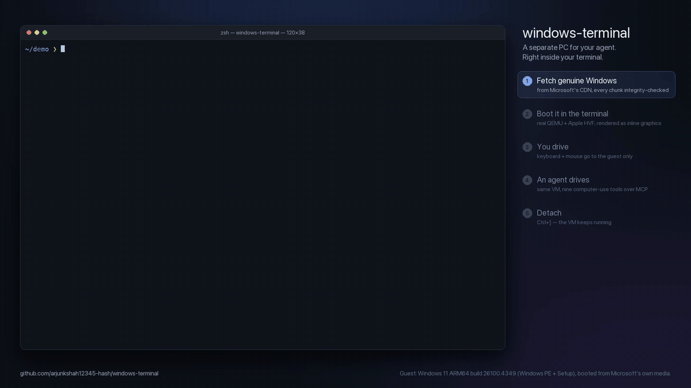

# windows-terminal

**A separate PC for your agent. Right inside your terminal.**



<sub>Unedited terminal capture, rendered from a recorded session (`demo/`). Download and boot waits are
time-lapsed and labelled. The guest is **genuine Windows 11 ARM64** (build 26100.4349), fetched by the tool from
Microsoft's own CDN; the demo boots its Windows PE + Setup environment. [Full-quality MP4](docs/demo.mp4).</sub>

`windows-terminal` runs a real QEMU virtual machine and draws its screen in your terminal. Your keyboard and
mouse go to the guest. Any MCP-capable agent can drive the **same** machine through nine computer-use tools,
without moving your host mouse, reading your clipboard, or touching your files. It is not a browser recreation
of Windows, and it is not Microsoft's Windows Terminal app.

```sh
windows-terminal fetch                       # genuine Windows 11 from Microsoft → bootable ISO
windows-terminal init --iso win11-*.iso --tpm --unattended
windows-terminal up --view                   # installs hands-free; Ctrl+] detaches, the VM keeps running
windows-terminal mcp                         # hand the same VM to your agent
```

## What works

- **Real Windows, fetched for you.** `fetch` reads Microsoft's Media Creation Tool catalog, downloads the
  official ESD from Microsoft's CDN (SHA-1 checked against the catalog), and rebuilds a bootable installation
  ISO with wimlib + xorriso. Nothing comes from third-party mirrors.
- **Hands-free installs.** `init --unattended` attaches a separate answer disc (`autounattend.xml`): it wipes
  only the VM's own disk, installs with Compact OS, creates a local account with auto-logon, skips the
  Microsoft-account and network screens, and keeps the machine awake for agents.
- **No "Press any key to boot from CD".** Fetched ISOs boot with Microsoft's no-prompt loader. For your own
  ISO, `up` presses the key for you, but only while the VM's disk is still blank.
  On ARM, QEMU's firmware sometimes registers the USB CD after its UEFI shell and lands there; fetched ISOs
  carry a `startup.nsh` in their EFI boot image that hands straight over to Windows Setup.
- Persistent named VMs, each with its own sparse disk (TRIM shrinks it), UEFI variables, and optional TPM 2.0.
- Legacy BIOS mode (`--boot bios`) for older x86 guests: Windows 7 and earlier, ReactOS.
- Apple silicon acceleration (HVF), Linux KVM, and a TCG fallback for cross-architecture guests.
- Kitty graphics in Kitty, Ghostty, and WezTerm; iTerm2 inline images; true-color half-blocks everywhere else
  (also used under tmux).
- Live keyboard, mouse clicks, dragging, scrolling, and resize-aware display.
- CLI screenshot, typing, shortcuts, clicks, pointer movement, and lifecycle commands.
- Nine MCP computer-use tools. Several viewers and agents can share one VM; monitor access is serialized.
- Offline checkpoints (disk, UEFI, and TPM together, verified with SHA256) that restore into a new VM.
- None of these: host pointer movement, clipboard access, shared folders, public control ports, account
  sign-in, or activation. Windows is installed unactivated with Microsoft's generic edition key.

## Get Windows

```sh
brew install wimlib xorriso          # Debian/Ubuntu: sudo apt install wimtools xorriso
windows-terminal fetch               # ~4.5 GB download → ~4 GB ISO (Windows 11 Pro, your host's architecture)
windows-terminal fetch --setup-only  # ~0.56 GB download → 0.9 GB ISO: boots real Windows PE + Setup, cannot install
```

`--setup-only` downloads only the byte ranges of Microsoft's ESD that hold Windows PE and Setup (the first
three images, about an eighth of the file) into a sparse file. Every downloaded 10 MB chunk is checked
against the ESD's own integrity table and wimlib re-verifies the SHA-1 of every extracted file. It is a
quick, small way to boot genuine Windows and is what the demo uses. Options: `--arch`, `--language en-gb`,
`--edition "Windows 11 Home"`, `--out DIR`, `--keep-download`.

## What has been verified

On an Apple silicon Mac (QEMU 11.1, HVF), recorded in the demo:

- `fetch --setup-only` downloads and builds a bootable ISO; a fresh VM boots it to **Windows 11 Setup**
  with no keypress.
- Inside genuine Windows (build 26100.4349, ARM64): keyboard, mouse, Shift+F10 command prompt, `wmic`, and
  Notepad, both from the viewer and from an agent over MCP.
- Windows Setup finds the `--unattended` answer disc and runs its first-pass commands.

**Not yet verified end to end:** a full installation to the desktop (needs ~20 GB of free disk, which the
test machine did not have), and networking in installed Windows on Arm. ARM guests get a USB RNDIS NIC,
because Windows on Arm has no e1000 driver; Windows PE has no driver for it at all. The full install path is
built from standard Microsoft answer-file settings, but treat it as experimental until it has been run to
completion. Reports welcome.

## Try ReactOS in two minutes

ReactOS, an open-source Windows-compatible OS, boots from a ~300 MB live CD. On Apple silicon it runs
emulated (TCG), so allow 1–2 minutes to boot.

```sh
curl -LO https://github.com/reactos/reactos/releases/download/0.4.15-release/ReactOS-0.4.15-release-1-gdbb43bbaeb2-x86-live.zip
unzip ReactOS-*-live.zip
windows-terminal init reactos --iso ReactOS-*-live.iso --arch x86_64 --boot bios --memory 1024 --cpus 1
windows-terminal up --vm reactos --view
```

## Requirements

Python 3.11+, QEMU, and a Windows installation ISO that matches the guest CPU.
This runs on **macOS, Linux, or Linux inside WSL2**. Native Win32 hosting is not
implemented; the controller uses Unix sockets and POSIX terminal APIs.

For Windows 11, install `swtpm` and use `--tpm` (`--unattended` also sets Windows Setup's documented
LabConfig bypasses for TPM/Secure Boot checks). `fetch` needs `wimlib` and `xorriso`. See
[What has been verified](#what-has-been-verified) for the current state of real Windows installs.

```sh
# macOS
brew install qemu swtpm

# Debian / Ubuntu (ARM hosts also need qemu-system-arm and qemu-efi-aarch64)
sudo apt install qemu-system-x86 qemu-utils ovmf swtpm

# In this checkout
python3 -m venv .venv
.venv/bin/python -m pip install -e .
source .venv/bin/activate
windows-terminal doctor
```

## Create and run

Use `windows-terminal fetch` or your own ISO from Microsoft. Windows is not bundled or activated by this
tool. On Apple silicon, use a **Windows ARM64** ISO; on Intel/AMD, use x64. The architecture defaults to
your host architecture.

For a hands-free install, add `--unattended` (account `agent` by default; `--user`, `--password` or
`$WINDOWS_TERMINAL_PASSWORD`, `--edition`). The password is stored in the VM's private `answer.iso` (mode 0600)
as Windows Setup requires; use a throwaway password.

```sh
windows-terminal init --iso ~/Downloads/Windows11_ARM64.iso --tpm
windows-terminal up --view
```

The viewer starts at the real firmware/installer. Complete Windows setup once
inside the guest. If firmware opens its boot manager, select the installation
media. Disk boot is preferred on subsequent starts; the installer is the
fallback while the disk is empty. You can eject it during installation:

```sh
windows-terminal eject
```

**Ctrl+] detaches** without stopping the VM. Ctrl+C goes to the guest. To use a
Windows shortcut that your terminal intercepts, send it from another terminal:

```sh
windows-terminal key win+r
windows-terminal type 'notepad.exe'
windows-terminal key enter
windows-terminal type 'Hello from my agent.'
windows-terminal screenshot desktop.png
windows-terminal click 500 300
windows-terminal scroll down --steps 4
windows-terminal down
```

The viewer recognizes modified navigation keys (for example Ctrl+arrows and
Shift+Ctrl+arrows) when the terminal sends standard modified-key sequences.
Bracketed pastes are validated before sending anything to the guest: only ASCII
text, tabs, and line breaks are accepted, up to 20,000 characters. Unsupported
characters or embedded control sequences reject the entire paste, so pasted
escape sequences cannot become shortcuts or detach the viewer. Line breaks
still press Enter inside the guest; review commands before pasting them.

Typing emulates a **US keyboard layout and ASCII text**. Unicode text is rejected
before any part of the string is sent. Host clipboard integration and text
extraction/OCR are intentionally not provided. Screenshot coordinates always
refer to the original guest image, not the terminal's downscaled preview.

## Isolation and networking

The default `--network isolated` blocks guest external connectivity, including
internet access. For a guest that needs the internet (including online Windows
setup), explicitly opt in at creation:

```sh
windows-terminal init work --iso ~/Downloads/windows.iso --tpm --network nat
windows-terminal up --vm work --view
windows-terminal mcp --vm work
```

**NAT is not a host/LAN security boundary.** It permits outbound connections and
can reach host services and the local network. It publishes no inbound ports.
The default isolated mode is safer for untrusted computer-use agents. QEMU is a
hypervisor, not a guarantee against malicious-guest escape vulnerabilities.

Every machine gets its own sparse qcow2 disk, NVRAM, and (when enabled) TPM state.
The default disk has a **64 GiB logical capacity**, not an immediate 64 GiB
allocation. Keep disk, NVRAM, and TPM files together; replacing TPM state can
make BitLocker-protected data inaccessible. Back up shut-down VMs as a unit.

## Offline checkpoints

Save a stopped guest before an agent changes it. Checkpoints include an independent
sparse qcow2 disk, private UEFI CODE/VARS, TPM state, and SHA256 integrity checks.
They do not include RAM, running processes, installation media, or logs.

```sh
windows-terminal down --vm work
windows-terminal status --vm work
windows-terminal checkpoint save clean --vm work
windows-terminal checkpoint list --vm work
windows-terminal checkpoint restore clean --vm work --as recovered
windows-terminal up --vm recovered --view
```

Wait until status says `stopped`; graceful shutdown may take time. Active or
unknown QMP sessions and busy TPM state are rejected. Prefer a clean guest
shutdown: a checkpoint after `down --force` is only crash-consistent.

Restore **requires a new VM name** and never overwrites an existing VM. Failed
copies are cleaned up; the original guest and checkpoint remain untouched.
Checkpoints are immutable: choose a new checkpoint name rather than replacing one.
The restored guest retains its original hardware UUID and TPM identity; do not
run original and restored copies together on the same network or domain.
The installer is detached, so restore is intended for an already installed OS.
Keep Windows/BitLocker recovery keys separately; Windows and BitLocker recovery
have not yet been tested. Checkpoints live at `<root>/<vm>/checkpoints/<name>`
and consume additional space proportional to used disk data, not logical capacity.

## Connect an agent over MCP

Add this stdio server to your MCP client (use the actual absolute executable path):

```json
{
  "mcpServers": {
    "windows-terminal": {
      "command": "/absolute/path/to/checkout/.venv/bin/windows-terminal",
      "args": ["mcp", "--vm", "windows"]
    }
  }
}
```

Tools: `screenshot`, `click`, `move`, `type`, `key`, `scroll`, `status`, `start`,
`stop`. Screenshots are native MCP image content. Tool failures return structured
errors. The server never writes banners or logs to protocol stdout, does not
execute arbitrary host shell commands, and cannot create new VMs or force power
off. Any connected agent can operate the selected guest, so only connect trusted
clients. Guest/web content must not be treated as agent instructions.

The bundled `skills/windows-terminal/SKILL.md` describes the computer-use loop.

## Commands

```text
fetch                      Download genuine Windows 11 from Microsoft, build a bootable ISO
  --setup-only            Only Windows PE + Setup (~0.56 GB download)
  --arch / --language / --edition / --out / --keep-download
init [NAME] --iso PATH     Create disk/config, never overwrite existing VMs
  --arch aarch64|x86_64    Guest architecture (host architecture by default)
  --memory 4096           Guest memory in MiB
  --cpus 4                Guest virtual CPUs
  --disk 64               Sparse disk logical capacity in GiB
  --firmware PATH         Explicit EDK2 CODE file, with matching VARS beside it
  --tpm                   TPM 2.0 via swtpm
  --network isolated|nat  Network policy, isolated by default
  --boot uefi|bios        bios = SeaBIOS + IDE for legacy x86 guests
  --unattended            Hands-free install via an attached autounattend.xml disc
    --user / --password / --edition
up [--view]               Start; optionally attach viewer (accepts --protocol/--fps)
view                      Attach to an already-running guest
  --protocol auto|kitty|iterm|blocks
  --fps 5                 Snapshot rate (1–15)
down [--force]            ACPI shutdown; --force loses unsaved work
list / status             JSON machine state
command                   Print generated QEMU argv as JSON
eject                     Eject installer media for the current boot
screenshot PATH           Write guest display as PNG
click X Y / move X Y      Guest-pixel input
key CHORD / type TEXT     Guest keyboard input; type reads stdin if text omitted
scroll up|down            Mouse wheel
mcp                       Serve MCP over stdin/stdout
doctor                    Read-only prerequisites report
checkpoint save NAME      Save complete offline disk/UEFI/TPM state
checkpoint list           List immutable checkpoints
checkpoint restore NAME --as NEW_VM
                          Restore into a new VM; never overwrite
```

Most machine commands accept `--vm NAME` (default: `$WINDOWS_TERMINAL_VM`, else
`windows`). Global `--root PATH` (before the subcommand, or `$WINDOWS_TERMINAL_ROOT`)
overrides storage. Otherwise it is
`${XDG_DATA_HOME:-~/.local/share}/windows-terminal`. VM logs are in
`<root>/<name>/qemu.log`. Long paths use a private short runtime socket directory.

## Limits and troubleshooting

- **No Windows ISO:** `init` fails with a concrete error. No fake desktop is
  substituted. `doctor`, MCP discovery, and unit tests work without an ISO.
- **No TPM:** Windows 11 installations may refuse setup. Install `swtpm`, create
  with `--tpm`. Existing configurations are intentionally not silently changed.
- **ARM graphics:** `ramfb` is an unaccelerated firmware/basic framebuffer. There
  is no GPU acceleration. ARM uses NVMe storage, e1000 networking, and USB input;
  actual driver compatibility depends on the Windows ISO. Additional signed
  guest drivers or firmware may be required.
- **Secure Boot:** Per-VM UEFI is provisioned, but Microsoft Secure Boot keys are
  not automatically enrolled. Select suitable firmware and provision keys when
  your guest requires them. This tool does not bypass Windows setup checks.
- **Slow VM:** Cross-architecture emulation uses TCG and can be very slow. Use a
  guest matching your host to get HVF/KVM. WSL2 KVM requires nested virtualization.
- **Shutdown still says stopping:** ACPI shutdown is a request; Windows may be
  waiting on setup or unsaved work. Inspect the viewer. `down --force` is an
  explicit hard power-off, never an automatic fallback.
- **Viewer/agent overlap:** Per-VM advisory locks serialize monitor connections;
  screen capture releases the lock each frame so agents can act concurrently.
- **Terminal graphics:** Use `view --protocol blocks` for an always-available
  lower-resolution fallback. Native Win32 terminals and sixel are not supported.
- **Keyboard:** ANSI arrows/navigation/function keys, ASCII, Ctrl shortcuts,
  mouse presses and drags work. OS-reserved shortcuts and arbitrary modified
  escape sequences may be intercepted by your terminal; use `key` via CLI/MCP.

## Recording the demo

`demo/record.py` runs zsh in a pseudo-terminal, types the commands, clicks with real
mouse escape sequences, and drives the VM from an MCP client. It saves every byte as
an asciicast (`session.cast`) plus timing markers. `demo/render.py` replays the bytes
through a terminal emulator (pyte), draws the viewer's inline images where the
terminal would, and encodes an MP4 with ffmpeg.

```sh
pip install -e '.[demo]'   # adds pyte; ffmpeg must be on PATH
python demo/record.py --out demo/out                      # genuine Windows 11 ARM64 (fetches ~0.56 GB)
python demo/record.py --guest reactos --iso ReactOS-*-live.iso --out demo/out
python demo/render.py demo/out --output docs/demo.mp4 --poster docs/poster.png
```

## Development

```sh
python3 -m unittest discover -s tests -v
WINDOWS_TERMINAL_LIVE_TESTS=1 python3 -m unittest discover -s tests -p 'test_live.py' -v
PYTHON=.venv/bin/python sh scripts/verify-release.sh
```

The release check builds a wheel, installs it and its dependencies in a temporary
virtual environment, then tests version reporting, host diagnostics, and MCP
initialization/tool discovery from outside the checkout. It needs package-index
access but never creates a VM. Successful artifacts and SHA256 checksums land in
`dist/`; the temporary environment is removed automatically. Install the wheel
with `python3 -m pip install dist/windows_terminal_vm-0.3.0-py3-none-any.whl`.

The live suite boots disposable ARM and x86 QEMU firmware guests, tests framebuffer
capture, keyboard/mouse input, MCP screenshots, terminal detach/restoration, and
TPM startup/persistence across restarts and offline checkpoint restoration,
then stops them. It does not
download/install Windows or touch your existing virtual machines. Windows
installer completion, Windows-specific input behavior, TPM-backed Windows boot,
and visual fidelity in each physical terminal still need manual validation.

On ARM macOS with HVF, TPM physical-presence-interface memory is disabled to
avoid an unaligned memory-map failure. TPM 2.0 emulation remains enabled; Windows
physical-presence operations have not been validated. Firmware copies preserve
zero-filled regions as sparse extents to avoid wasting host disk space.
